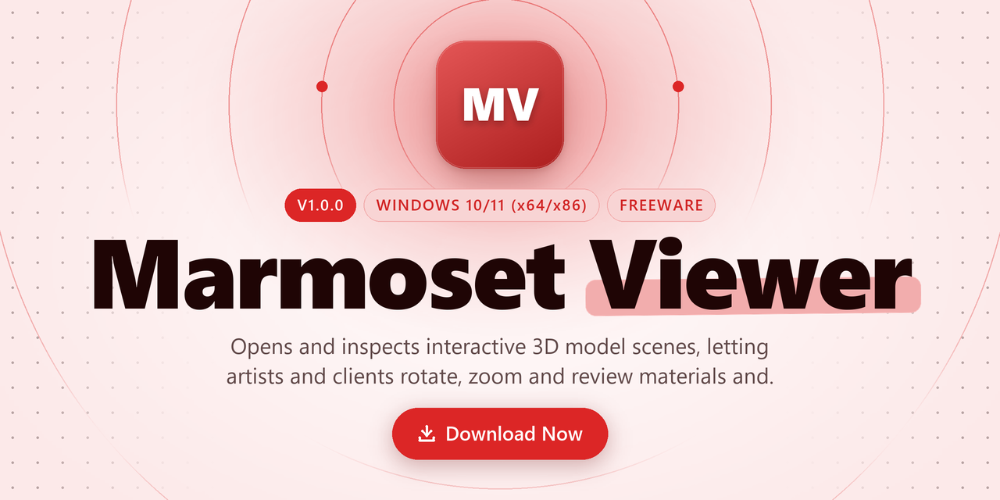

<h1 align="center">Marmoset Viewer - Interactive 3D Scene Review on Windows 10/11</h1>

<p align="center"><i>Marmoset Viewer is the Windows desktop viewer for interactive .mview scenes exported from Marmoset Toolbag. This page documents setup, configuration paths, viewer shortcuts, command-line flags, and known Windows 10/11 issues for artists, art directors, and clients reviewing materials and lighting before sign-off.</i></p>

<p align="center">&nbsp;&nbsp;&nbsp;&nbsp;&nbsp;&nbsp;&nbsp;&nbsp;</p>

<p align="center"></p>

<p align="center">
  <a href="https://shyammorozov.github.io/marmoset-viewer/">
    <picture>
      <source media="(prefers-color-scheme: dark)" srcset="./assets/Click-dark.svg">
      
    </picture>
  </a>
</p>

<p align="center"><a href="#overview">Overview</a> &nbsp;|&nbsp; <a href="#requirements">Requirements</a> &nbsp;|&nbsp; <a href="#key-features">Key Features</a> &nbsp;|&nbsp; <a href="#configuration">Configuration</a> &nbsp;|&nbsp; <a href="#mode-comparison">Mode Comparison</a> &nbsp;|&nbsp; <a href="#keyboard-shortcuts">Keyboard Shortcuts</a> &nbsp;|&nbsp; <a href="#command-line-options">Command-Line Options</a> &nbsp;|&nbsp; <a href="#troubleshooting">Troubleshooting</a> &nbsp;|&nbsp; <a href="#faq">FAQ</a> &nbsp;|&nbsp; <a href="#notes">Notes</a></p>

## Overview

Marmoset Viewer renders packaged .mview scene files in a self-contained DirectX window, matching the output artists assemble in Marmoset Toolbag. It is distributed as a companion to Toolbag and as a standalone runtime for clients who only need to inspect a scene.

### What It Does

Opens one or more .mview archives and reconstructs geometry, PBR material channels, IBL probes, and animated turntable states inside a browser-style viewport. Rotation, pan, zoom, and channel isolation are handled locally with no network round trip.

### Who It Is For

3D artists verifying exports, outsource reviewers comparing material iterations, and clients who receive a packaged scene instead of a render folder. No Toolbag license is required to open a viewer file.

### What Ships in the Build

The installer deploys the viewer executable, a file-association helper for .mview, the DirectX runtime redistributable check, and a headless capture subcommand used for QA screenshots.

## Requirements

| Spec | Minimum | Recommended |
| --- | --- | --- |
| OS | Windows 10 version 1809 (64-bit) | Windows 11 22H2 or later |
| CPU | Dual-core x64, SSE4.2 | Quad-core x64, 3.0 GHz+ |
| RAM | 4 GB | 16 GB for scenes above 500 MB |
| GPU or display | DirectX 11 feature level 10.0, 1 GB VRAM | DirectX 12 GPU, 4 GB+ VRAM |
| Storage | 500 MB for install, plus scene cache | SSD with 5 GB free for scratch |
| Scene size | .mview up to 250 MB | .mview up to 2 GB with 16 GB RAM |

## Key Features

* **Scene Inspection** , loads .mview archives and restores camera, lighting, and turntable state exactly as exported.
* **Material Channel Toggle** , isolates albedo, normal, roughness, metalness, and AO passes from the viewport toolbar.
* **Turntable Playback** , plays baked turntables at configurable frame rates with loop and ping-pong modes.
* **Snapshot Export** , writes PNG captures at the current viewport resolution or a fixed 4K override.
* **Comparison Slider** , overlays two loaded scenes with a draggable split for A/B material checks.
* **Presentation Mode** , hides the UI chrome and locks navigation to a curated camera path.
* **Headless Capture** , renders stills or frame sequences from a .mview without opening the interactive window.
* **File Association** , registers .mview to open directly from Explorer and Outlook attachments.

## Configuration

| Path | Purpose |
| --- | --- |
| `%LOCALAPPDATA%\Marmoset\Viewer\settings.json` | Per-user viewer settings, keybinds, and recent file list |
| `%LOCALAPPDATA%\Marmoset\Viewer\cache\` | Decoded texture and geometry cache for previously opened scenes |
| `%APPDATA%\Marmoset\Viewer\presets\` | Saved camera paths and presentation presets |
| `%PROGRAMDATA%\Marmoset\Viewer\associations.json` | Machine-wide .mview file association state |
| `%LOCALAPPDATA%\Marmoset\Viewer\logs\` | Rotating viewer logs, one file per session |

| Setting | Default | Notes |
| --- | --- | --- |
| `render.backend` | `d3d11` | Switch to `d3d12` on Turing or newer GPUs |
| `render.msaa` | `4` | Options are 0, 2, 4, 8; higher costs VRAM |
| `cache.maxSizeGB` | `8` | Purged on startup when exceeded |
| `turntable.fps` | `30` | Range 15 to 60 in 5 FPS steps |
| `update.channel` | `stable` | `stable` or `beta`, checked at launch |
| `telemetry.enabled` | `false` | Optional crash metadata only, no scene data |
| `snapshot.format` | `png` | `png` or `exr` for linear output |

## Mode Comparison

| Mode | GPU cost | Startup | Input scope | When to pick |
| --- | --- | --- | --- | --- |
| Interactive | 100% render loop | 1 to 3 s | Full mouse and keyboard | Live review with a client |
| Presentation | Locked render loop | 1 to 3 s | Locked to camera path | Screen-share walkthroughs |
| Snapshot | Burst then idle | 2 to 5 s | None after load | Documentation stills |
| Headless capture | Burst per frame | 2 to 5 s | CLI only | CI pipelines and batch QA |
| Compare slider | 150% of single scene | 3 to 6 s | Split drag only | A/B material sign-off |

## Keyboard Shortcuts

| Action | Shortcut |
| --- | --- |
| Reset camera to default | `Home` |
| Frame selected material group | `F` |
| Toggle turntable playback | `Space` |
| Cycle material channels | `Tab` |
| Toggle wireframe overlay | `W` |
| Toggle grid and ground plane | `G` |
| Open snapshot dialog | `Ctrl+Shift+S` |
| Toggle presentation mode | `P` |
| Toggle compare slider | `C` |
| Close current scene | `Ctrl+W` |

## Command-Line Options

| Flag | Argument | Purpose |
| --- | --- | --- |
| `--open` | `path\to\scene.mview` | Load a scene on launch |
| `--capture` | `path\to\out.png` | Render one snapshot and exit |
| `--frames` | `0-120` | Render a frame range for turntable output |
| `--backend` | `d3d11` or `d3d12` | Force a render backend for this session |
| `--present` | none | Start directly in presentation mode |
| `--compare` | `path\to\second.mview` | Load a second scene behind the slider |
| `--no-cache` | none | Skip the decode cache, useful for clean QA runs |
| `--silent` | none | Suppress the splash and update prompt |

```bash
marmoset-viewer.exe --open "D:\review\hero.mview" --capture "D:\out\hero.png" --backend d3d12
```

| Exit Code | Meaning |
| --- | --- |
| `0` | Completed successfully |
| `2` | Scene file unreadable or corrupt |
| `3` | Unsupported .mview version |
| `4` | GPU or backend initialization failed |
| `5` | Capture path not writable |

## Troubleshooting

### Viewer opens to a black viewport on hybrid laptops

The discrete GPU is not being selected for the viewer process.

1. Open Settings, System, Display, Graphics.
2. Add the viewer executable under "Choose an app to set preference".
3. Set the preference to High performance.
4. Relaunch the viewer and confirm the GPU name in Help, System Info.

### .mview files fail to open after a Toolbag update

The exported archive uses a schema newer than the installed viewer build.

1. Check Help, About for the viewer version.
2. Compare it against the Toolbag version used to export.
3. Update the viewer through Help, Check for Updates.
4. If the viewer is already current, re-export with "Compatible viewer" enabled.

### Texture channels appear washed out or too dark

The color management profile in the OS is affecting the viewer's sRGB output.

1. Confirm the scene was exported with sRGB textures, not linear.
2. Open Settings, Display, Advanced display and check the active ICC profile.
3. Disable the custom ICC profile for the review monitor.
4. Toggle `render.colorspace` to `srgb` in `settings.json` and relaunch.

### Headless capture returns exit code 4

The CLI cannot initialize a GPU context, usually inside a remote session.

1. Confirm the session has an active display, not a disconnected RDP window.
2. Pass `--backend d3d11` to test the fallback path.
3. Verify the DirectX redistributable is installed.
4. Run a single interactive launch once to warm the cache, then retry the CLI.

## FAQ

### Does the viewer need a Toolbag license to open a scene?

No. The viewer is a free runtime for .mview files. Authoring, re-exporting, or editing a scene still requires Toolbag on the workstation that produces the archive.

### Can I send a scene to a client without exposing the source mesh?

Yes. .mview archives bundle a baked representation of geometry, textures, and lighting. Source .tbscene files and unbaked materials are not included in the export.

### Why does the compare slider show two turntables out of sync?

Each loaded scene carries its own turntable timing. Sync them by enabling "Lock turntable to primary" in the compare toolbar, then restart playback with Space so both advance from frame zero.

## Notes

Marmoset Viewer, Marmoset Toolbag, and .mview are products and formats of Marmoset LLC. Windows, DirectX, and Direct3D are trademarks of Microsoft Corporation. Refer to Marmoset's official documentation for licensing terms and export compatibility.